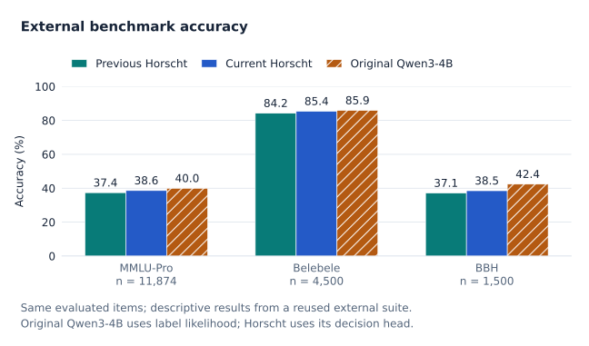
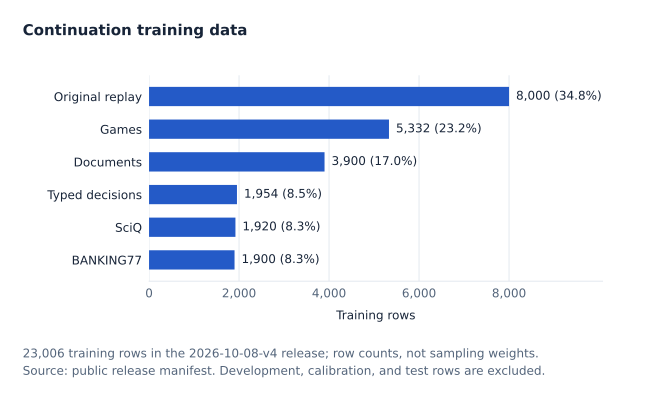
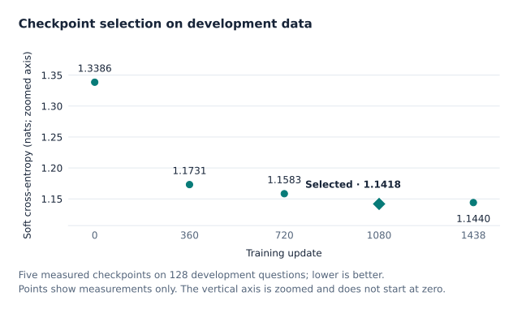
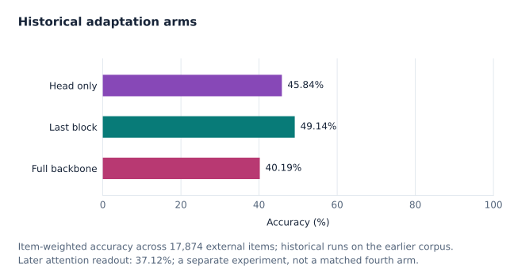
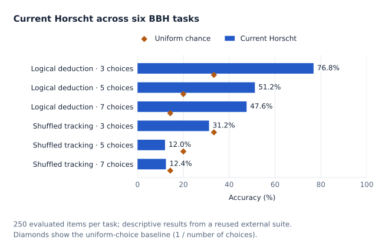

# Horscht: a 265-choice decision model with limited Qwen3-4B adaptation

Nicolas Mahn · Project technical report · 2026-10-09 · Exploratory results

## Abstract

Horscht adapts the post-trained Qwen3-4B backbone to return a probability distribution over 2–265 supplied text choices in one forward pass. A normalized last-token representation feeds a linear decision head; the final transformer block and head are trained while earlier backbone weights remain frozen. The current checkpoint continues a prior 128,263-row training run on a 23,006-row mixture of historical replay, engine-verified games, independently reviewed document questions, and public training partitions. A fixed 128-row development subset selects update 1080 from five saved candidates. On a previously observed 17,874-item external suite, the selected checkpoint reaches 50.40% accuracy, compared with 49.14% for its warm start and 51.72% for the original Qwen3-4B immediate-answer label-likelihood reference. The current model reaches 38.63% on MMLU-Pro, 85.40% on five Belebele language variants, and 38.53% on six BBH tasks. These are descriptive results from adaptive benchmark reuse, not a new confirmatory test. A separate 64-row temperature fit is exploratory, and the internal test remains deferred. We report the adaptation contract, data lineage, experiment history, aggregate evidence, and unresolved generalization and redistribution limits.

## 1. Purpose and scope

The project investigates whether a language model's representation can support a simple decision interface without generating an answer or a reasoning trace. An application supplies context, a question, and candidate options. Horscht returns probabilities and a selected option. The choices can change between requests; output positions refer to the choices in the current request rather than a global label vocabulary. This creates a compact interface for classification, document questions, finite decisions, and tasks with explicit outcome distributions.

The contribution is a documented implementation and experiment record. We do not claim a new transformer architecture, a generally superior decision model, or that one forward pass removes the reasoning demands of a task. The released backbone is **Qwen3-4B**, not Qwen3.5. An initial small template-based experiment favored post-trained Qwen3: mean development accuracy was 88.125%, versus 84.6875% for Qwen3.5 and 82.1875% for Qwen3 Base, across ten seeds with 64 training and 64 development rows. This explains the local backbone choice; its narrow task scope cannot establish a general ranking. The [original experiment record](../original-experiments.md) describes this initial experiment.

## 2. Model and learning objective

The pinned backbone is `Qwen/Qwen3-4B` at revision `1cfa9a7208912126459214e8b04321603b3df60c`. It has 36 transformer blocks. The project loads its language backbone without the vocabulary output head: 4,022,468,096 backbone parameters in the recorded runtime. Only block 35, comprising 100,930,816 parameters, and the 678,665-parameter decision head are trainable. Embeddings, blocks 0–34, and the final backbone normalization remain frozen. The frozen prefix has no autograd graph; the frozen final normalization still propagates gradients into the trainable last block. The adaptation therefore trains 101,609,481 parameters, approximately 2.53% of the deployed backbone-plus-head parameters. The [Qwen3 technical report](https://arxiv.org/abs/2505.09388) describes the upstream model family; the [pinned run manifest](evidence.json) records this project's counts.

Inputs use the plain `context`, `question`, and numerically labeled `options` fields, ending in `Selected choice:`. Targets, explanations, IDs, language tags, provenance, and split metadata are excluded. This is the project formatter, rather than a generated-thinking chat interaction. The last non-padding hidden state is normalized with a non-affine LayerNorm and passed through a learned affine map with 265 outputs. For an input with K choices, logits at positions K and above are masked before softmax. Argmax ties resolve to the lowest valid index. There is no text generation, reinforcement-learning reward, or learned stopping policy. The implementation is in [experiment.py](../../experiment.py).

Writing the normalized representation as h and valid logits as z, the decision distribution is p(j | x) = exp(z_j) / Σ_{i<K} exp(z_i). The per-row objective is cross-entropy −Σ_{j<K} q_j log p_j, where q is either a one-hot hard label or the complete recorded soft target. A target distribution can describe a stipulated stochastic process, an empirical frequency, or a teacher judgment; these meanings are not interchangeable. Agreement with a teacher target is not evidence that the target is true. Accepted probability-sum drift up to 2 × 10⁻⁶ is normalized at the tensor boundary while preserving raw source values.

Choice permutations move option text, stable choice identities, labels, and all target probabilities together. A conservative detector preserves original order for ambiguous letter or relative-position references. A fixed slot head does not guarantee permutation invariance; augmentation and consistency diagnostics address only observed cases. An abstention choice, where present in training data, is a supplied semantic option. There is no reserved universal abstention slot, and softmax confidence alone is not an abstention guarantee.

## 3. Data provenance and separation

The historical corpus contains 142,629 rows. Its immutable 2026-10-01 snapshot contains 128,263 training, 7,202 development, and 7,164 test rows. Much of this historical material was AI-authored; structural validation and recorded probability evidence must not be mistaken for comprehensive independent semantic or language verification. The [probability-target contract](../probability-dataset-v2.md) distinguishes exact derivations, explicit stochastic processes, empirical frequencies, and unverified teacher estimates. The current continuation does not use the proposed one-million-row target in that document as an achieved dataset size.

The 2026-10-08-v4 continuation snapshot contains 43,723 rows. Related documents, translations, game states, trajectories, parent links, choice-order variants, and historical groups are joined before splitting or sampling. Original split assignments are retained, including historical rows omitted from replay. Previously trained groups cannot become holdouts; conflicting connected groups are excluded. Calibration contains only fresh, unlinked groups. These controls reduce known leakage paths but do not prove semantic independence.

| Source | Train | Development | Calibration | Internal test |
| --- | ---: | ---: | ---: | ---: |
| Historical replay / retained holdouts | 8,000 | 7,202 | 0 | 7,164 |
| Independently reviewed documents | 3,900 | 1,655 | 324 | 278 |
| Engine-verified games | 5,332 | 1,898 | 265 | 505 |
| Typed Decisions public train | 1,954 | 199 | 143 | 104 |
| SciQ public train | 1,920 | 190 | 158 | 132 |
| Banking77 public train | 1,900 | 195 | 155 | 150 |
| **Total** | **23,006** | **11,339** | **1,045** | **8,333** |

Counts come from the [frozen snapshot](evidence.json) and [admission record](../new-dataset-2026-10-08.md). The 8,333-row internal test consists of 7,164 historical rows with experimental history and 1,169 fresh rows; they require separate reporting. Neither cohort was evaluated in the latest completion receipt.

The train split has 148 language tags, 7,471 genuinely non-one-hot targets, and 10,307 rows with more than four choices. Only 45 training rows have exactly 265 choices. Reviewed document training has 3–12 choices, so the current data does not establish reviewed document performance at maximum cardinality. Language counts indicate presence, not fluent or balanced coverage. Public additions are English.

Document contexts retain complete frozen source texts and checksums. The v4 admission excluded a connected development group of 19 rows after one formatted context exceeded the configured budget; no context was cropped. Training uses a 40,960-token budget, with a measured maximum of 37,609 tokens and a complete forward/backward preflight on that maximum. This is a configured and exercised runtime budget, not a demonstrated long-context accuracy result. The upstream [Qwen3-4B model card](https://huggingface.co/Qwen/Qwen3-4B) describes 32,768 native context tokens; this report does not relabel the project's larger budget as the advertised native window. The locked external evaluator retains its 32,768-token cap and disables truncation.

Public acquisition uses pinned **training-only** partitions. The source manifest records revisions, raw and converted checksums, attribution, and license evidence. Typed Decisions is recorded as Apache-2.0, Banking77 as CC-BY-4.0, and SciQ as CC-BY-NC-3.0. Typed Decisions is a training source here, not an independent benchmark. MMLU-derived training material was not admitted because MMLU-Pro is used for evaluation. The admitted document train/development rows include CC-BY-SA-4.0, CC-BY-3.0, CC-BY-4.0, CC0, OGL-3.0, and CC-BY-2.0 source material; a grant for original contributions does not replace these source terms. SciQ's noncommercial terms and document-source rights prevent treating the entire mixture or resulting checkpoint as an unrestricted commercial release without further rights review. See the [dataset release record](../../release/dataset/README.md) for artifact-specific redistribution decisions.

The frozen overlap audit screened all 43,723 snapshot rows against the 17,874 external items. It recorded zero exact matches, zero near lexical matches, and zero truncated candidate pairs. This is a lexical screen, not proof of absent paraphrase overlap or absent upstream pretraining contamination. Benchmark content remains isolated from training discovery and authoring; reports contain aggregate results only.

## 4. Experiment design and execution

The experiment sequence was exploratory. Small frozen-backbone readout tests and a 32/16/16 head-versus-full pilot preceded larger training. An overnight stage preceded the matched current-corpus comparisons. Those stages used different data or exposure and are historical context, not pooled replications. The principal old-corpus comparison used the same 128,263 training rows, 37,756,818 formatted tokens, seed, initial linear-head state, aligned permutations, and one-epoch budget for frozen-backbone head-only, final-block-plus-head, and full-backbone-plus-head arms. Their development-selected checkpoints were evaluated on the same external suite. The last-block warm start was selected at update 8,017. A later option-conditioned attention-head experiment changed the head architecture while retaining final-block adaptation; its result is an architecture experiment, not a proof that every attention readout is inferior. The [project record builder](../../build_project_record.py) links the successive receipts.

The continuation warm-started weights from that last-block checkpoint but reset the optimizer, scheduler, sample cursor, and seeded RNG. Two 128-update pilots compared head learning rates 10⁻⁴ and 10⁻³ with a fixed final-block rate of 10⁻⁵. Development soft cross-entropy selected 10⁻⁴; the main run restarted from the original warm start, rather than pilot-trained weights. Training used Adafactor with factored FP32 second moments, no first-moment accumulator, no weight decay, and update clipping at 1.0. A 3% warmup and cosine decay shared the 1,438-update main budget. Microbatches held one question and gradients accumulated over 16 questions, with a partial final update. The main run completed one pass over 23,006 training rows; this is an additional mixture, not the model's complete lifetime training count. See [the protocol](evidence.json) and [pilot choice](evidence.json).

Execution used an AMD Radeon 8060S Graphics device, PyTorch 2.11.0+rocm10.0.0, Transformers 5.17.0, FP32 parameters, BF16 autocast, and flash attention. Audited recovery revisions resumed from saved optimizer boundaries after resource interruptions. They retained scheduler, RNG, optimizer, and cursor state. Compact training checkpoints reference a checksummed immutable warm-start checkpoint and carry changed tensors; they are not standalone full backbones. The portable export verifies all 387 non-final-block tensors against the pinned upstream backbone cast to FP32, then packages 11 final-block tensors and two head tensors. A CPU inference smoke test passed with an invented input and verified the formatter, normalization, pooling, and mask; GPU export equivalence remains untested. Release restoration and distribution details belong to the [model release record](../../release/model/README.md). No controlled latency or energy comparison is reported.

The original plan used full development selection over 5,417 rows at updates 0, 360, 720, 1080, and 1438. A recorded deadline amendment changed remaining selection to a shared fixed stratified **128-row** subset and calibration to **64 rows**. Source quotas and language/token bands were chosen without outcomes. All five saved candidate hashes were bound before external inference. Selection minimized development soft cross-entropy; ties favored earlier updates. Diagnostic argmax agreement did not select the checkpoint. The original full-development and full-calibration plans are not completed claims for this release.

| Update | Development soft CE (nats) | Target argmax agreement |
| ---: | ---: | ---: |
| 0 | 1.338602 | 58.59% |
| 360 | 1.173092 | 59.38% |
| 720 | 1.158349 | 61.72% |
| **1080 · selected** | **1.141830** | **64.84%** |
| 1438 | 1.144004 | 66.41% |

The 0.002174-nat difference between updates 1080 and 1438 is small. It follows the declared rule, but is not evidence of a statistically reliable ranking. The selected checkpoint precedes the end of the completed main pass. Its reload was verified before evaluation. The [selection receipt](evidence.json) and [completion receipt](evidence.json) bind this result.

A positive scalar temperature T = 0.917470 was fitted to the separate 64-row calibration subset within bounds 0.05–20. Calibration cross-entropy changed from 1.264237 to 1.262020 nats on the **fit subset**; this is not an out-of-sample calibration improvement. The scalar preserves argmax. All external scores below use the original masked softmax, **without temperature scaling**. The separately recorded temperature is not part of those benchmark probabilities. The new internal test remains deferred.

## 5. Aggregate results

The external suite includes all 11,874 items in the locked MMLU-Pro test slice, 900 items in each of five Belebele variants (German, English, French, Spanish, and Chinese), and 250 items in each of six BBH tasks: three logical-deduction and three shuffled-object-tracking cardinalities. It is not all Belebele languages or all BBH tasks. The composite is a question-count-weighted accuracy over 17,874 rows; it is not an equal-task average or a standard cross-project decision index. Belebele's translated variants share underlying problems, so they must not be treated as independent observations for uncertainty calculations.

| Evaluation slice | Rows | Previous last-block | Current update 1080 | Change | Original immediate-answer |
| --- | ---: | ---: | ---: | ---: | ---: |
| MMLU-Pro | 11,874 | 37.36% | **38.63%** | +1.27 pp | 39.95% |
| Belebele · five variants | 4,500 | 84.22% | **85.40%** | +1.18 pp | 85.89% |
| BBH · six tasks | 1,500 | 37.13% | **38.53%** | +1.40 pp | 42.40% |
| **Weighted overall** | **17,874** | **49.14%** | **50.40%** | **+1.26 pp** | **51.72%** |

The current model answers 9,008 rows correctly, compared with 8,783 for its warm start: a net aggregate difference of 225 rows. This is not a claim that precisely 225 particular errors were fixed; item-level transitions were not analyzed. The original reference answers 9,245 correctly. Both current and original reference avoid generated thinking traces, but the reference scores label likelihoods through the original vocabulary head, a different readout and prompt protocol. It is an immediate-answer reference, not a matched architecture arm or a thinking-mode baseline.

| Decision model | Overall accuracy | NLL (nats) ↓ | Summed multiclass Brier ↓ |
| --- | ---: | ---: | ---: |
| Previous last-block | 49.14% | 1.5325 | 0.6286 |
| Current update 1080 | **50.40%** | **1.4879** | **0.6172** |

NLL is mean −log p of the gold choice. Brier is the mean sum of squared differences between the valid-choice probabilities and the one-hot gold vector, without division by choice count. These same-readout probability metrics improved descriptively. We do not infer calibrated real-world confidence from this reused suite. Probability metrics from the original vocabulary readout have different interpretation and are deliberately not used as a calibration superiority claim.

For the earlier matched old-corpus arms, the aggregate record is:

| Old-corpus adaptation | Overall | MMLU-Pro | Belebele | BBH |
| --- | ---: | ---: | ---: | ---: |
| Head only; backbone frozen | 45.84% | 32.06% | 85.29% | 36.60% |
| Final block + linear head | **49.14%** | **37.36%** | **84.22%** | **37.13%** |
| Full backbone + linear head | 40.19% | 28.37% | 73.89% | 32.67% |
| Later final block + attention head | 37.12% | 30.48% | 56.87% | 30.40% |

The linear-head comparison supports retaining limited final-block adaptation **under that recorded training recipe**. It does not establish that restricted adaptation generally beats full fine-tuning, which may require a different learning rate or exposure. The later attention arm is shown separately in time and protocol; changing architecture can change optimization behavior. The current continuation changes data, learning-rate schedule, token budget, initialization history, and selection scope together. Its gain cannot be attributed causally to any one new source, to longer inputs, or to soft targets alone. No source-removal ablations or multi-seed large-run replications were completed.

All external aggregates above derive from allowlisted aggregate artifacts. The latest aggregate checksum is verified against its completion receipt in the [report evidence](evidence.json); no benchmark questions, answers, or per-item predictions are included.

## 6. Related work

Horscht builds on the Qwen3 model family and applies an ordinary affine classification readout to a pretrained representation. Qwen3's upstream report distinguishes reasoning and non-reasoning uses; our decision-head experiment should not be read as a measurement of its generated-reasoning ceiling. [Yang et al., *Qwen3 Technical Report*](https://arxiv.org/abs/2505.09388).

Adafactor supplies the low-memory factored second-moment optimizer used here. Temperature scaling is a standard one-parameter probability adjustment; fitting it to constructed soft targets measures agreement with those targets rather than automatically validating empirical correctness probabilities. [Shazeer and Stern, *Adafactor*](https://arxiv.org/abs/1804.04235); [Guo et al., *On Calibration of Modern Neural Networks*](https://arxiv.org/abs/1706.04599).

MMLU-Pro targets more challenging multi-task language understanding, Belebele measures parallel multilingual reading comprehension, and BBH collects challenging tasks with substantial reasoning demands. Our source slices and direct-decision protocol are narrower than the full benchmark definitions. [Wang et al., *MMLU-Pro*](https://arxiv.org/abs/2406.01574); [Bandarkar et al., *The Belebele Benchmark*](https://arxiv.org/abs/2308.16884); [Suzgun et al., *Challenging BIG-Bench Tasks*](https://arxiv.org/abs/2210.09261).

Community decision models offer alternative interfaces: Kev uses a pointer over supplied options, while ImaJev documents a linear decision readout. Mica and InnerJev document additional adaptation or reasoning-distillation recipes. These are useful methodological references, but none was evaluated locally for this report. Their differing backbones, data, request limits, and harnesses prevent converting published scores into a Horscht head-to-head result or a recommendation to replace the locally selected backbone. [Kev model card](https://huggingface.co/jaredpalmer/kev-4b); [ImaJev model card](https://huggingface.co/mohit67890/imajev-4b); [Mica model card](https://huggingface.co/sky7350/Mica-v0.1-4B); [InnerJev model card](https://huggingface.co/jylin001206/InnerJev-4B-Full). Their details remain author-reported metadata, as recorded in the [dated peer review](../../build_peer_comparison_report.py).

## 7. Limitations and next evidence

Repeated observation of external scores influenced the project trajectory. Even though the latest checkpoint was selected on internal development data and frozen before external inference, the suite as a whole is an adaptively reused research resource. The experiment therefore cannot supply an untouched final-test claim. Pretraining contamination remains unknown, and lexical overlap screening is insufficient to exclude semantic overlap.

The 128-row selection subset and 64-row calibration subset are small relative to the data's languages, context lengths, and choice counts. Large-run results have one training seed, no paired item-transition analysis, and no fresh internal-test aggregate. We report no significance test or binomial interval: translations and related tasks violate simple independence assumptions, and adaptivity would remain unresolved by an interval. The reported changes are descriptive finite-suite differences.

The mixture combines hard labels, constructed probabilities, and teacher estimates with uneven review quality. Source counts alone cannot certify targets or language fluency. Historical row envelopes record `split: train` throughout; the frozen split sidecars, rather than that legacy field, are authoritative. High-cardinality coverage is sparse, choice-order invariance is not guaranteed, and no published score here establishes universal abstention behavior, image understanding, safety, or suitability for consequential decisions. Long-input execution was checked; long-input answer quality was not established by a dedicated length-controlled study. Latency, throughput, and energy benefits require controlled measurements.

The most informative next result would be one predeclared evaluation on fresh, independently verified task groups after fixing checkpoint and temperature. Report historical and fresh internal cohorts separately; stratify by target source, language, context length, and cardinality; preserve translations as linked groups. Source-removal and same-seed matched-protocol ablations could then test hypotheses about the new mixture. Until that evidence exists, the result is a modest observed continuation gain and a reproducible decision-model artifact with clear limits.

## Appendix A. Reproduction and evidence

The report snapshot is dated 2026-10-09. [paper.md](paper.md) is the editable source; [paper.html](paper.html) is a standalone rendering with embedded styles and no remote dependencies. Install `docs/paper/requirements.txt` if needed, then run `uv run --group paper python docs/paper/render.py` from the repository root. With local receipts present, it verifies source hashes and aggregate bindings before rendering; in a public checkout it validates and uses the committed `evidence.json` snapshot. This command reads only explicit aggregate/manifest allowlists and performs no model inference or benchmark download. The five figures are rebuilt with Matplotlib from those aggregates and the published dataset manifest; editable vector SVG and high-resolution PNG copies are saved under `figures/`. The HTML embeds each vector figure so it can also be read as a single offline file. Tables remain available beneath the figures.

To restore the selected decision model, use the [release model instructions](../../release/model/README.md) and its checksum-bound portable artifact. Preserve the pinned upstream revision, tokenizer, non-affine normalization, choice mask, and plain input formatter. A trainable overlay is a dependency on its verified base, not a free-standing model. The training checkpoints also preserve optimizer, scheduler, sample cursor, and RNG for audited continuation. Do not substitute a Qwen3.5 checkpoint or a different tokenizer.

To reconstruct the mixture, consult [the dataset release](../../release/dataset/README.md), pinned public-source acquisition manifest, and original source-rights evidence. The stages are `dataset_factory.new_public_data`, `dataset_factory.new_dataset`, `dataset_factory.new_dataset_quarantine`, and `dataset_factory.new_overlap`. Existing immutable destinations are refused. Use the corrected Qwen3 tokenizer receipt rather than the original admission receipt's Qwen3.5 representative lengths. Access to private or restricted source material may be required; a public artifact's presence must not be taken as permission to reconstruct or redistribute the full mixture.

The selected checkpoint manifest SHA-256 is `0bb4234d8f364c8219e79cee2ca29d8ee41031584bd89dd38830a29a1dac08d7`. The snapshot manifest SHA-256 is `6413df891b6ee10073c8e49f4c3c0b19375c495ff595ab7889a4386e7bb427fd`. The external aggregate SHA-256 is `dcaceb9121c5d81b8a1b3d4c66881e7b3a5ef5a2d671559dfad3d297350a5e93`. The evidence file records the remaining source paths and content hashes. The receipt completed at `2026-10-09T12:40:46.729400+00:00`.

External benchmark reproduction must follow the repository's [blind benchmark rules](../../.cursor/rules/blind-benchmarks.mdc): keep content evaluation-only, freeze the model before inference, suppress content-bearing logs, and publish only aggregate metrics. The complete suite is fixed at 17,874 rows with a 32,768-token cap, no truncation, no generated reasoning, and no temperature scaling. Re-running it remains exploratory. This report does not initiate that run or expose the evaluation inputs.

## Appendix B. Disclosure

This is a project technical report, not a peer-reviewed publication. The report was drafted with AI assistance from repository records and aggregate receipts. Experimental claims remain bounded by those artifacts; no institutional affiliation, funding, or independent peer review is claimed. Public-source metadata and bibliography were checked on 2026-10-09. A bibliographic search returned an unsolicited third-party per-item diagnostic snippet; that page was not opened, the content was not reused, and the accidental exposure is recorded without reproducing it. No external benchmark item files were read during report preparation.
